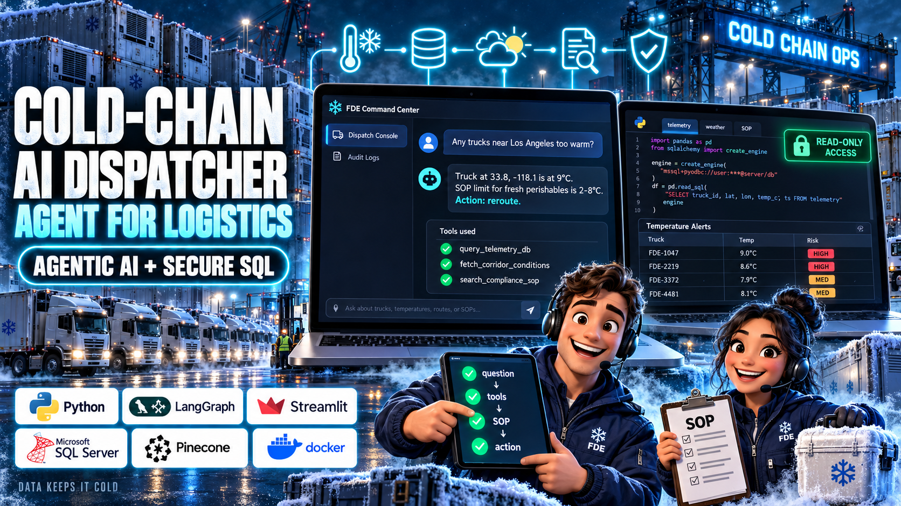

# Cold-Chain AI Dispatcher



An AI agent that answers questions about refrigerated trucks in plain English.
It reads fleet data from a SQL database, live weather from a public API, and company rules from a vector database.
Then it writes a short report with the action that the dispatcher must take.

## Contents

1. [The problem](#1-the-problem)
2. [The solution](#2-the-solution)
3. [The stack and why we use it](#3-the-stack-and-why-we-use-it)
4. [How it works](#4-how-it-works)
5. [Project layout](#5-project-layout)
6. [Build it step by step](#6-build-it-step-by-step)
7. [Deploy to AWS EC2](#7-deploy-to-aws-ec2)
8. [Known limits](#8-known-limits)

## 1. The problem

Some trucks carry food or medicine that must stay cold.
If the cargo gets too warm, it spoils.
A dispatcher watches the trucks and must act fast when something goes wrong.

To make one decision, the dispatcher must check three systems:

| Question | Where the answer is |
| :--- | :--- |
| Where is the truck, and how cold is the cargo? | An old company database |
| Is the weather a risk at that location? | A weather service |
| What do the company rules tell me to do? | A long policy document (SOP) |

This takes time.
The old database also has cryptic column names such as `IOT_TEMP_VAL_C`, so it is hard to query.

## 2. The solution

The dispatcher types one question into a chat page. For example:

> Find any active shipments near Los Angeles (Latitude ~33.8, Longitude ~-118.1). Check the local weather there, and tell me if the current cargo temperature violates the SOP for fresh perishables.

The AI agent then does these steps:

1. It reads the question and decides which tools it needs.
2. It writes a SQL query and gets the truck data.
3. It gets the live weather at the truck location.
4. It searches the SOP for the temperature rule.
5. It writes a report with a summary, a data table, and the action plan.

The agent can also decide to use no tools.
For a general question, such as "What is a Tier 2 escalation?", it can answer from the SOP only.

### Safety

You must not give an AI full access to a company database.
This project uses three controls:

- **Read-only login.** The agent uses the `USR_FDE_RO` login. This login can read data, but it cannot change data.
- **Clean view only.** The agent can see only the view `FDE_VIEWS.VW_ACTIVE_FLEET`. The database denies access to the raw table.
- **Audit log.** The app writes each tool call and each answer to the table `FDE_VIEWS.AgentAuditLog`.

## 3. The stack and why we use it

| Part | Tool | Why |
| :--- | :--- | :--- |
| Language | Python 3.12 | All the AI libraries support Python first. |
| Agent | LangGraph | It lets the agent loop between "think" and "use a tool" until it has an answer. |
| LLM | OpenAI, DeepSeek, or local Ollama | You select one in `.env`. Ollama runs free on your own machine. |
| Legacy database | Microsoft SQL Server 2022 in Docker | Many large companies still use SQL Server. Docker makes it easy to start. |
| Rules search | Pinecone | It finds SOP text by meaning, not only by exact words. |
| Embeddings | OpenAI or `BAAI/bge-m3` | These models change text into vectors for Pinecone. `bge-m3` is free and local. |
| Weather | Open-Meteo API | It is free and needs no API key. |
| User interface | Streamlit | It makes a chat page in pure Python. |
| Hosting | AWS EC2 and GitHub Actions | One button in GitHub deploys the new code to the server. |

## 4. How it works

```
                 Dispatcher
                     |
                     v
          +---------------------+
          |  Streamlit chat UI  |----> AgentAuditLog (SQL)
          +---------------------+
                     |
                     v
          +---------------------+
          |  LangGraph agent    |
          |  reasoner <-> tools |
          +---------------------+
             |       |        |
             v       v        v
     SQL Server   Open-Meteo   Pinecone
     (read-only   (weather)    (SOP rules)
      view)
```

The agent has two nodes:

- **reasoner**: The LLM reads the conversation. It writes a final answer, or it asks for one or more tools.
- **tools**: This node runs the tools and gives the results back to the reasoner.

The loop stops when the reasoner writes an answer and asks for no more tools.

## 5. Project layout

```
.github/workflows/deploy.yml     Manual deploy to EC2
data/raw/                        The logistics dataset (CSV)
data/policy/                     SOP documents for Pinecone
data/cache/                      File hashes, so ingestion skips files that did not change
docs/images/                     Images for this README
docs/instrutions.md              The original build notes, phase by phase
scripts/ingest_legacy_data.py    Loads the CSV into SQL Server
scripts/setup_security_and_view.sql  Makes the view and the read-only login
scripts/ingest_sop_pinecone.py   Loads the SOP files into Pinecone
src/agent_tools.py               The 3 tools
src/orchestrator.py              The LangGraph agent and a terminal chat loop
src/prompts/system_prompt.txt    The report format for the LLM
src/ui.py                        The Streamlit app
```

## 6. Build it step by step

### Before you start

Install these items:

- Python 3.12
- Docker Desktop
- [ODBC Driver 18 for SQL Server](https://learn.microsoft.com/en-us/sql/connect/odbc/download-odbc-driver-for-sql-server)
- VS Code with the "SQL Server (mssql)" extension by Microsoft
- A free [Pinecone](https://app.pinecone.io/) account
- Optional: [Ollama](https://ollama.com/) for a free local LLM

### Step 1: Get the code and install the packages

```bash
git clone https://github.com/nimowhyca/cold-chain-logistics-FDE-Project.git
cd cold-chain-logistics-FDE-Project
python -m venv venv
venv\Scripts\activate          # Windows
# source venv/bin/activate     # Linux or macOS
pip install -r requirements.txt
```

### Step 2: Make the `.env` file

Make a file with the name `.env` in the project root.
Git ignores this file, so your keys stay on your machine.

```ini
# LLM: OPENAI, DEEPSEEK, or any other value for local Ollama
Agent_llm=OLLAMA
OPENAI_API_KEY=
DEEPSEEK_API_KEY=

# Embeddings: OPENAI, or any other value for the local model
Embeddings_model=LOCAL
Local_Embedding_Model=BAAI/bge-m3
PINECONE_API_KEY=your-pinecone-key

# SQL Server
SQL_SERVER_HOST=localhost
SQL_SERVER_PORT=1433
SQL_ADMIN_USER=sa
SQL_ADMIN_PASSWORD=your-strong-sa-password
SQL_AGENT_USER=USR_FDE_RO
SQL_AGENT_PASSWORD=your-agent-password
```

If you use Ollama, download the model first:

```bash
ollama pull qwen2.5:7b
```

### Step 3: Start the legacy database

**Why:** This step makes a copy of an old company database on your machine.

```bash
docker run -e "ACCEPT_EULA=Y" -e "MSSQL_SA_PASSWORD=your-strong-sa-password" -p 1433:1433 --name legacy-mssql -d mcr.microsoft.com/mssql/server:2022-latest
```

Use the same password as `SQL_ADMIN_PASSWORD` in `.env`.

### Step 4: Load the dataset

**Why:** Real legacy tables often have cryptic column names.
This script copies that problem on purpose, so that the next step can fix it.

The dataset comes from [Kaggle](https://www.kaggle.com/datasets/datasetengineer/logistics-and-supply-chain-dataset).
A copy is in `data/raw/`.

```bash
python scripts/ingest_legacy_data.py
```

The important part of the script renames the clean columns to legacy names:

```python
legacy_mapping = {
    'timestamp': 'TS_UTC',
    'vehicle_gps_latitude': 'V_LAT',
    'vehicle_gps_longitude': 'V_LON',
    'iot_temperature': 'IOT_TEMP_VAL_C',
    'risk_classification': 'RISK_CLS_TXT',
    # ...
}
df_legacy = df[list(legacy_mapping.keys())].rename(columns=legacy_mapping)
df_legacy.to_sql('TBL_SC_FLEET_HIST_RAW', engine, if_exists='replace', index=False, schema='dbo')
```

To check the result, connect to the database in VS Code as `sa`.
Then run this query:

```sql
SELECT COUNT(*) AS total_rows FROM dbo.TBL_SC_FLEET_HIST_RAW;
```

In the VS Code connection, set "Trust server certificate" to on and "Encrypt" to Optional.

### Step 5: Add the security layer

**Why:** An LLM can write a bad query.
The database must block that query, so you do not depend on the LLM to behave.

1. Open `scripts/setup_security_and_view.sql`.
2. Change the agent password in the script to the value of `SQL_AGENT_PASSWORD`.
3. Run the script in VS Code as `sa`.

The script does three things:

```sql
-- 1. A view with clean column names
CREATE VIEW FDE_VIEWS.VW_ACTIVE_FLEET AS
SELECT TS_UTC AS [Timestamp],
       V_LAT  AS [Latitude],
       CAST(IOT_TEMP_VAL_C AS FLOAT) AS [Current_Temperature_C],
       ...
FROM dbo.TBL_SC_FLEET_HIST_RAW;

-- 2. A login for the agent
CREATE LOGIN USR_FDE_RO WITH PASSWORD = '...';

-- 3. Read access to the view only
GRANT SELECT ON FDE_VIEWS.VW_ACTIVE_FLEET TO USR_FDE_RO;
DENY SELECT ON dbo.TBL_SC_FLEET_HIST_RAW TO USR_FDE_RO;
DENY INSERT, UPDATE, DELETE, ALTER ON SCHEMA::dbo TO USR_FDE_RO;
```

Connect again as `USR_FDE_RO` and do these two tests:

```sql
-- Test 1: This query must work.
SELECT TOP 5 * FROM FDE_VIEWS.VW_ACTIVE_FLEET;

-- Test 2: This query must fail with a permission error.
SELECT TOP 5 * FROM dbo.TBL_SC_FLEET_HIST_RAW;
```

### Step 6: Make the audit log table

**Why:** A manager must be able to see what the AI did and why.

Run this SQL as `sa`:

```sql
CREATE TABLE FDE_VIEWS.AgentAuditLog (
    LogID INT IDENTITY(1,1) PRIMARY KEY,
    Timestamp DATETIME DEFAULT GETDATE(),
    SessionID VARCHAR(50),
    NodeExecuted VARCHAR(50),
    ToolName VARCHAR(100),
    Content NVARCHAR(MAX)
);

GRANT INSERT ON FDE_VIEWS.AgentAuditLog TO USR_FDE_RO;
```

The agent can add rows to this table, but it cannot read or change them.

### Step 7: Load the SOP into Pinecone

**Why:** The LLM does not know your company rules.
This step stores the rules so that the agent can search them by meaning.
This method is called RAG (Retrieval-Augmented Generation).

```bash
python scripts/ingest_sop_pinecone.py
```

The script does these steps:

1. It reads each `.md`, `.txt`, `.pdf`, `.csv`, and `.xlsx` file in `data/policy/`.
2. It cuts each file into chunks of 600 characters. Markdown files are cut at the headings first.
3. It changes each chunk into a vector and stores it in Pinecone.
4. It stores a hash of each file in `data/cache/`. On the next run, it skips files that did not change.

The index name depends on `Embeddings_model`:

| `Embeddings_model` | Index | Vector size |
| :--- | :--- | :--- |
| `OPENAI` | `fde-sop-index-openai` | 1536 |
| any other value | `fde-sop-index-local` | 1024 |

Use the same value for ingestion and for the app.
If you change the value, delete `data/cache/ingestion_hash_cache.json` and run the script again.

### Step 8: Test the tools

**Why:** Make sure that each tool works alone before you connect it to the LLM.

```bash
python src/agent_tools.py
```

You must see truck rows, a weather report, and SOP text.

A tool is a normal Python function with the `@tool` decorator.
The LLM reads the docstring to know when and how to use the tool:

```python
from langchain_core.tools import tool

@tool
def fetch_corridor_conditions(latitude: float, longitude: float) -> str:
    """
    Fetches real-time weather and corridor conditions from a live REST API for given GPS coordinates.
    Provides temperature, wind speed, and computed corridor congestion index.
    """
    url = f"https://api.open-meteo.com/v1/forecast?latitude={latitude}&longitude={longitude}&current_weather=true"
    payload = requests.get(url, timeout=6).json().get("current_weather", {})
    return f"External Temp: {payload.get('temperature')}°C | Wind Speed: {payload.get('windspeed')} km/h"
```

The SQL tool also blocks any query that does not start with `SELECT`.
The database permissions from Step 5 are the second control.

### Step 9: Build the agent

**Why:** The agent decides which tools to use and in which order.

This is the core of `src/orchestrator.py`:

```python
from langgraph.graph import StateGraph, START
from langgraph.prebuilt import ToolNode, tools_condition
from langgraph.checkpoint.memory import MemorySaver

fde_tools = [query_telemetry_db, fetch_corridor_conditions, search_compliance_sop]
llm_with_tools = llm.bind_tools(fde_tools)

def reasoning_node(state):
    return {"messages": [llm_with_tools.invoke(state["messages"])]}

graph = StateGraph(AgentState)
graph.add_node("reasoner", reasoning_node)
graph.add_node("tools", ToolNode(fde_tools))
graph.add_edge(START, "reasoner")
graph.add_conditional_edges("reasoner", tools_condition)  # tool call -> "tools", else end
graph.add_edge("tools", "reasoner")

fde_agent = graph.compile(checkpointer=MemorySaver())  # memory per thread_id
```

Start the chat in the terminal:

```bash
python src/orchestrator.py
```

Ask these two test questions:

1. The "domino effect" test. The agent must use all 3 tools.
   ```
   Find any active shipments near Los Angeles (Latitude ~33.8, Longitude ~-118.1). Check the local weather there, and tell me if the current cargo temperature violates the SOP for fresh perishables.
   ```
2. The "restraint" test. The agent must not query the database.
   ```
   I'm a new dispatcher on the night shift. Can you quickly explain the difference between a Tier 1 and Tier 2 escalation?
   ```

Type `exit` to stop.

### Step 10: Start the web app

```bash
streamlit run src/ui.py
```

Open http://localhost:8501. The app has two pages:

- **Dispatch Console**: The chat. Each tool call shows its input and its output in a box that you can expand.
- **Security & Audit Logs**: Enter the admin login to see the audit table.

## 7. Deploy to AWS EC2

### Set up the server one time

1. Start an EC2 instance: Ubuntu, `c7i-flex.large`, 30 GB storage.
2. In the security group, open port 8501 for the app. Open port 1433 only if the database is on a different server.
3. Install Docker and start SQL Server as in Step 3. Add `-v mssql_data:/var/opt/mssql` to keep the data after a restart.
4. Install the app:
   ```bash
   sudo apt update && sudo apt install -y python3-pip python3-venv git
   cd /home/ubuntu
   git clone https://github.com/nimowhyca/cold-chain-logistics-FDE-Project.git
   cd cold-chain-logistics-FDE-Project
   python3 -m venv venv
   source venv/bin/activate
   pip install -r requirements.txt
   ```
5. Install the ODBC driver:
   ```bash
   curl -fsSL https://packages.microsoft.com/keys/microsoft.asc | sudo gpg --dearmor -o /usr/share/keyrings/microsoft-prod.gpg
   curl -fsSL https://packages.microsoft.com/config/ubuntu/$(lsb_release -rs)/prod.list | sudo tee /etc/apt/sources.list.d/mssql-release.list
   sudo apt-get update
   sudo ACCEPT_EULA=Y apt-get install -y msodbcsql18 unixodbc-dev
   ```
6. Copy your `.env` file to the server.
7. Make the file `/etc/systemd/system/streamlit.service`:
   ```ini
   [Unit]
   Description=Streamlit Cold-Chain Dispatch Console
   After=network.target

   [Service]
   User=ubuntu
   WorkingDirectory=/home/ubuntu/cold-chain-logistics-FDE-Project
   ExecStart=/home/ubuntu/cold-chain-logistics-FDE-Project/venv/bin/streamlit run src/ui.py --server.port=8501 --server.address=0.0.0.0
   Restart=always

   [Install]
   WantedBy=multi-user.target
   ```
8. Start the service:
   ```bash
   sudo systemctl daemon-reload
   sudo systemctl enable streamlit
   sudo systemctl start streamlit
   ```

### Deploy new code

1. In GitHub, add the secrets `EC2_HOST`, `EC2_USER`, and `EC2_SSH_KEY` to the environment `FDE-YT-Cold`.
2. Go to **Actions > Enterprise Manual Deploy > Run workflow**.

The workflow connects to the server with SSH.
It pulls the `main` branch and restarts the service.
It does not install new packages, so run `pip install -r requirements.txt` on the server after you change `requirements.txt`.

## 8. Known limits

- The Streamlit app does not send `src/prompts/system_prompt.txt` to the LLM. Only the terminal chat in `src/orchestrator.py` uses it. Thus, answers in the web app can have a different format.
- The agent memory (`MemorySaver`) is in RAM. A restart deletes all chat history.
- The SQL tool returns a maximum of 10 rows for each query.
- The weather tool calculates the congestion index from the wind speed only. It is a demo value.
- `src/agent_tools.py` connects to Pinecone when Python imports it. If `PINECONE_API_KEY` is missing, the app stops at start.
